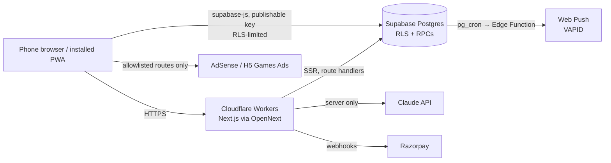

# Document 2 — Build prompt for VS Code

Build plan and prompts for an AI coding agent in VS Code: the Claude Code extension, GitHub Copilot agent mode, or Cline. It produces the WillWar landing page and PWA on Next.js 16, Supabase and Cloudflare, with the domain registered at Hostinger.

---

## 0. Before the first prompt

1. Create an empty Git repo and open it in VS Code.
2. Copy everything in `03-repo-guardrails/` to the repo root, including the hidden `.github/` folder.
3. Copy `01-design/DESIGN.md` to `docs/design/DESIGN.md`.
4. Put the Open Design exports in `design/exports/` (file names are in the Handoff table of Document 1).
5. Put your skill files where Claude Code finds them:
   - `.claude/skills/frontend-design/SKILL.md` ← `Frontend_Design.md`
   - `.claude/skills/mobile-app-ui-design/SKILL.md` ← `Mobile_App_Design.md`
   - `.claude/skills/dev-engineering-super-skill/SKILL.md` ← `Dev_Engineerinfg_AI_Skill.md`
   - `.claude/skills/ai-agent-super-skill/SKILL.md` ← `AI_Agent_Super_Skill.md`
   The last two refer to `scripts/*.py` tools that are not in this repo. They are guidance only; `AGENTS.md` tells the agent not to run them.
6. Create accounts: Cloudflare (free), Supabase, Anthropic API, Razorpay, Resend, Google Cloud (OAuth client), Google AdSense. Apply for the H5 Games Ads beta on day one; approval takes time.
7. Paste the **Master prompt** (section 2). Then paste **one phase prompt at a time** (section 6). Don't start a phase until the previous phase's acceptance criteria pass.

## 1. Ship order (today is Saturday 31 October 2026)

The season starts tomorrow. Don't wait for the full product to ship the landing page.

| Target | Phases | What's live |
|---|---|---|
| Sun 1 – Mon 2 Nov | 0, 1 | Domain, landing page, pledge list, share card. Collect emails while November search traffic peaks. |
| By Sat 7 Nov | 2, 3, 4, 5 | Installable PWA: onboarding, the Tide clock, check-ins, reset, Ride it out with Drift and Swell. Late starters can set their start to 1 Nov on the honor system. |
| By Sat 14 Nov | 6, 7 | Morning lines, pacts, the three leaderboards, nudges. |
| By Sat 21 Nov | 8, 9, 9b (promise mode) | Learn, Razorpay (season pass, annual), house ads; AdSense and H5 when approved. War Chest in promise mode (no money moves). |
| December | 10, 11, 9b (stake mode) | Push reminders, hardening, rolling 30-day resets as the year-round product. War Chest stake mode only after the legal sign-off in `docs/guardrails/war-chest.md`. Plan NNN 2027. |

---

## 2. Master prompt (paste once)

```
You are the senior full-stack engineer and tech lead for "WillWar", an 18+ Progressive Web App for the No Nut November challenge and rolling 30-day resets. I am the founder. I want a product that feels like a native iOS app, protects extremely sensitive data, and makes money through a free tier with ads and a Pro tier behind a hard paywall.

READ BEFORE WRITING ANY CODE
- AGENTS.md (non-negotiables, commands, repo map)
- docs/guardrails/*.md (privacy-security, content-health-claims, ai-safety, ads-monetization, war-chest, design-implementation, pwa-native-feel, social-integrity, release-checklist)
- docs/design/DESIGN.md (source of truth for every visual value)
- design/exports/* (visual references from Open Design; DESIGN.md wins on conflicts)
- .claude/skills/*/SKILL.md (frontend-design, mobile-app-ui-design, dev-engineering-super-skill, ai-agent-super-skill). The last two mention scripts/*.py that don't exist here; never run them.
- This build prompt, which I'll also save as docs/BUILD_PLAN.md.

PRODUCT
- Landing page at / : one interactive page; the hero button "Start my 30 days" goes to /app/start; "Sign in" goes to /app/sign-in.
- The app at /app (PWA scope): onboarding with an 18+ age gate; the Tide streak clock; daily check-in; reset flow; daily AI morning line; Ride it out urge mode with three-minute games (Drift, Swell, Knots) and intensity logging; Pacts with challenges, nudges and three leaderboards (current streak, best streak in season, days kept in season); Learn articles with evidence grades; Me stats; Settings; Pro paywall; ads on allowed placements only; a free signed pledge at onboarding and the War Chest, an optional money commitment offered once (forfeits go to a cause the user picks, never to us; the rest is refunded when the challenge ends).

WORKING AGREEMENTS
1. Plan, then wait. At the start of each phase, reply with a plan: files to add or change, migrations, dependencies, risks, and how you'll verify. Wait for me to say "go".
2. Docs beat this prompt. Library APIs change. Before using any API named here, check the current official docs. If something here is out of date, tell me and follow the docs.
3. TypeScript strict. No `any`. Zod at every boundary (route handlers, RPC inputs, env vars, AI output, webhook payloads).
4. Server Components by default; "use client" only for interaction, browser APIs or animation.
5. Tests with every change: Vitest for logic, pgTAP for database and RLS, Playwright (iPhone 15 and Pixel 8 profiles) for flows.
6. Never weaken a guardrail to make something pass. If a guardrail blocks you, stop and ask me.
7. Ask before adding a dependency that isn't in the stack table.
8. Small conventional commits. Update docs/CHANGELOG.md at the end of each phase.
9. When a phase is done, list exactly how I can verify it on my phone.

Confirm you've read the files by summarizing the non-negotiables in AGENTS.md in five lines, then propose Phase 0.
```

---

## 3. Stack decisions

| Concern | Choice | Notes |
|---|---|---|
| Framework | Next.js 16 (App Router), React 19.2, TypeScript strict | Use the newest 16.2.x patch, at least 16.2.6, which fixed a batch of security advisories. `proxy.ts` replaces `middleware.ts`. `next lint` is gone; run ESLint directly. |
| Hosting | Cloudflare Workers via `@opennextjs/cloudflare` | Cloudflare now recommends vinext for new apps, but it's beta. Start on OpenNext; confirm the adapter supports your Next 16 minor before pinning. Revisit vinext after launch (`npx vinext check`). |
| Domain | Hostinger (registrar) → Cloudflare nameservers | Runbook in section 7. |
| Styling | Tailwind CSS v4, tokens as CSS variables from DESIGN.md | `@theme` maps tokens to utilities. |
| Motion | `motion` (motion.dev), View Transitions API | Springs from DESIGN.md section 7. |
| Icons | `@phosphor-icons/react` | Never SF Symbols. |
| Primitives | Radix UI primitives (dialog, tabs, toggle group, accordion) | Accessibility for sheets and segmented controls. |
| PWA | `app/manifest.ts` + Serwist (`@serwist/turbopack`) | Fallback: a hand-written `public/sw.js` if the Serwist route doesn't pre-render under OpenNext. |
| Backend | Supabase: Postgres, Auth, RLS, Realtime, pg_cron, Edge Functions | `@supabase/ssr` and `@supabase/supabase-js`. Use the publishable key in the browser and the secret key only on the server. |
| AI | Claude API via `@anthropic-ai/sdk` | Model from `ANTHROPIC_MODEL`, default `claude-haiku-5-5`; confirm the current model ID in Anthropic's docs. |
| Payments | Razorpay: Orders (season pass, War Chest stakes), Subscriptions (annual, UPI AutoPay and cards), Refunds API (War Chest returns) | International cards via Razorpay International first; a merchant of record later if needed. Refunds use the `X-Refund-Idempotency` header; normal refunds aren't possible on payments older than 6 months, hence the 90-day cap on staked challenges. |
| Ads | `AdSlot` abstraction: house ads → AdSense (Learn feed) → H5 Games Ads (post-game, rewarded) | Flags per provider; non-personalized; route allowlist. |
| Bot protection | Cloudflare Turnstile | Pledge form and Supabase Auth CAPTCHA. |
| Email | Supabase Auth custom SMTP via Resend | Plain, discreet subject lines. |
| Local data | IndexedDB via `idb` | Offline queue, on-device journal. |
| Analytics | Cloudflare Web Analytics on public pages; first-party `events` table in the app | No third-party trackers or session replay under /app. |
| Tests | Vitest, Playwright, pgTAP (`supabase test db`) | |
| Lint and format | ESLint flat config + Prettier (or Biome alone) | |

---

## 4. Architecture



### Routes

| Path | Type | Notes |
|---|---|---|
| `/` | Static | Landing |
| `/learn`, `/learn/[slug]` | Static (MDX) | Public articles, SEO |
| `/day/[n]` | Static | "No Nut November day N" pages, 1–30 |
| `/privacy`, `/terms`, `/health`, `/support` | Static | Legal and safety |
| `/app/start` | Client | Onboarding (age gate first) |
| `/app/sign-in`, `/app/auth/callback` | Mixed | Email code and Google |
| `/app/today` | Dynamic | Start URL of the installed app |
| `/app/urge`, `/app/urge/[game]`, `/app/urge/done` | Client | Ride it out |
| `/app/pact`, `/app/pact/[id]`, `/app/join/[code]` | Dynamic | Pacts |
| `/app/learn`, `/app/learn/[slug]` | Static | Same MDX inside app chrome |
| `/app/me`, `/app/settings`, `/app/pro` | Dynamic | |
| `/app/war-chest` | Dynamic | Setup flow and detail screen |
| `/app/offline` | Static | Precached offline page |
| `/api/waitlist` | POST | Turnstile + insert with secret key |
| `/api/affirmation` | POST | Cached daily morning line |
| `/api/coach` | POST, streaming | Pro only, not persisted |
| `/api/razorpay/checkout`, `/api/razorpay/webhook` | POST | |
| `/api/rewards/shield` | POST | Rewarded-ad grant, capped |
| `/api/war-chest/checkout` | POST | Stake mode: `create_stake_chest` + Razorpay Order |
| `/api/cron/war-chest-settle` | POST (cron, secret header) | Daily: `settle_due_war_chests`, then refunds |
| `/war-chest/report` | Static, rebuilt monthly | Public donation totals and receipts per cause |
| `/api/push/subscribe` | POST | |
| `/api/account/export`, `/api/account/delete` | POST | |
| `/api/og/streak` | GET | Share card image |

### Folders

```
src/
  app/
    (marketing)/page.tsx, learn/, day/, privacy/, terms/, health/, support/
    app/                     # PWA scope /app
      layout.tsx             # AppShell: glass tab bar, Ride it out pill
      start/ sign-in/ auth/callback/ today/ urge/ pact/ join/[code]/ learn/ me/ settings/ pro/ offline/
    api/ ...
    manifest.ts
    sw.ts                    # Serwist service worker source
  components/ui/             # Button, Sheet, Cell, Segmented, Chip, Toast, IntensityScale
  components/tide/           # Tide (canvas), Clock, MilestoneRing
  components/games/          # GameHost, drift/, swell/, knots/
  components/ads/            # AdSlot, HouseAd, providers/
  lib/supabase/              # browser.ts, server.ts, admin.ts (server-only)
  lib/ai/                    # client.ts, prompts.ts, filters.ts, fallback.ts
  lib/time/                  # streak math, timezone, season windows
  lib/offline/               # idb queue, sync
  lib/payments/razorpay.ts     # orders, subscriptions, refunds, webhook verification
  lib/war-chest/              # amounts, copy, eligibility client, settlement worker
  lib/config/                # crisis-resources.ts, ads.ts, plans.ts
  env.ts                     # Zod-validated env (server and client split)
  proxy.ts                   # session refresh for /app/*
content/
  learn/*.mdx                # articles with evidence frontmatter
  affirmations.json          # curated fallback lines
  sponsors.json              # house ads and direct sponsors
supabase/
  migrations/0001_core.sql
  tests/*.sql                # pgTAP
  functions/send-reminders/  # Edge Function
docs/  design/  .claude/skills/
```

---

## 5. Database (migration `supabase/migrations/0001_core.sql`)

Reference implementation, validated on 31 October 2026 against Postgres 16 with Supabase-style `auth` stubs and Supabase's default grants: it applies cleanly, blocks under-18 sign-ups, returns zero rows across users, hides pacts from non-members, denies `anon`, rate-limits nudges, computes the three leaderboard metrics correctly, shows the War Chest offer once and only when eligible, forfeits 25% per reset (Steady) or everything (Strict), refunds exactly the stake minus forfeits, rejects tampered payment amounts, and keeps every money-moving function out of reach of signed-in users. The agent adapts it, keeps every guarantee, and covers it with pgTAP tests. Writes to sensitive tables happen only through `security definer` functions that validate input and derive dates on the server.

```sql
-- ============ Tables ============
create table public.profiles (
  id uuid primary key references auth.users(id) on delete cascade,
  handle text not null unique check (handle ~ '^[a-z0-9_]{3,20}$'),
  avatar_seed text not null default encode(extensions.gen_random_bytes(6), 'hex'),
  adult_confirmed_at timestamptz not null,           -- date of birth is never stored
  timezone text not null default 'Asia/Kolkata',
  tone text not null default 'steady' check (tone in ('steady','stoic','coach','playful')),
  why_tags text[] not null default '{}',
  discreet_notifications boolean not null default true,
  leaderboard_visibility text not null default 'pacts'
    check (leaderboard_visibility in ('private','pacts','global')),
  show_backed_badge boolean not null default false,  -- War Chest badge on boards (never an amount)
  war_chest_offered_at timestamptz,                  -- the one-time War Chest offer has been shown
  created_at timestamptz not null default now()
);

create table public.streaks (
  id uuid primary key default gen_random_uuid(),
  user_id uuid not null references public.profiles(id) on delete cascade,
  started_at timestamptz not null,
  ended_at timestamptz,
  created_at timestamptz not null default now(),
  constraint streak_order check (ended_at is null or ended_at >= started_at)
);
create unique index streaks_one_open on public.streaks(user_id) where ended_at is null;
create index streaks_user_started on public.streaks(user_id, started_at desc);

create table public.checkins (
  user_id uuid not null references public.profiles(id) on delete cascade,
  local_date date not null,
  status text not null check (status in ('held','reset','shielded')),
  created_at timestamptz not null default now(),
  primary key (user_id, local_date)
);

create table public.resets (                          -- tags only, never free text
  id uuid primary key default gen_random_uuid(),
  user_id uuid not null references public.profiles(id) on delete cascade,
  occurred_at timestamptz not null default now(),
  tags text[] not null default '{}' check (
    tags <@ array['late_night','bored','stressed','alone','scrolling','drinking','other']::text[])
);

create table public.urge_sessions (
  id uuid primary key default gen_random_uuid(),
  user_id uuid not null references public.profiles(id) on delete cascade,
  started_at timestamptz not null default now(),
  game text not null check (game in ('drift','swell','knots')),
  duration_s int not null check (duration_s between 0 and 1800),
  intensity_before smallint check (intensity_before between 1 and 10),
  intensity_after smallint check (intensity_after between 1 and 10),
  completed boolean not null default false
);

create table public.seasons (
  id text primary key check (id ~ '^[a-z0-9-]{3,40}$'),
  name text not null,
  starts_on date not null,
  ends_on date not null check (ends_on >= starts_on)
);
insert into public.seasons (id, name, starts_on, ends_on)
values ('nnn-2026', 'No Nut November 2026', '2026-11-01', '2026-11-30');

create table public.season_members (
  season_id text not null references public.seasons(id) on delete cascade,
  user_id uuid not null references public.profiles(id) on delete cascade,
  joined_at timestamptz not null default now(),
  primary key (season_id, user_id)
);

create table public.goals (                            -- the challenge window: a season or a custom end date
  id uuid primary key default gen_random_uuid(),
  user_id uuid not null references public.profiles(id) on delete cascade,
  season_id text references public.seasons(id),
  ends_on date not null,                               -- last day, in the profile's timezone
  pledge_signed_at timestamptz,                        -- the free first commitment (foot in the door)
  created_at timestamptz not null default now(),
  closed_at timestamptz
);
create unique index goals_one_open on public.goals(user_id) where closed_at is null;

create table public.pacts (
  id uuid primary key default gen_random_uuid(),
  name text not null check (char_length(name) between 2 and 40),
  owner_id uuid not null references public.profiles(id) on delete cascade,
  season_id text references public.seasons(id),
  invite_code text not null unique default encode(extensions.gen_random_bytes(5), 'hex'),
  max_members int not null default 5 check (max_members between 2 and 50),
  created_at timestamptz not null default now()
);

create table public.pact_members (
  pact_id uuid not null references public.pacts(id) on delete cascade,
  user_id uuid not null references public.profiles(id) on delete cascade,
  joined_at timestamptz not null default now(),
  primary key (pact_id, user_id)
);

create table public.challenges (
  id uuid primary key default gen_random_uuid(),
  pact_id uuid not null references public.pacts(id) on delete cascade,
  kind text not null check (kind in ('first_to_days','longest_streak','most_days')),
  target_days int check (target_days between 1 and 365),
  starts_at timestamptz not null,
  ends_at timestamptz not null,
  created_by uuid not null references public.profiles(id) on delete cascade,
  check (ends_at > starts_at)
);

create table public.nudges (
  id uuid primary key default gen_random_uuid(),
  pact_id uuid not null references public.pacts(id) on delete cascade,
  from_user uuid not null references public.profiles(id) on delete cascade,
  to_user uuid not null references public.profiles(id) on delete cascade,
  message_key text not null check (message_key in
    ('proud_of_you','ride_it_out','day_one_counts','almost_there','with_you')),
  created_at timestamptz not null default now()
);

create table public.affirmations (
  user_id uuid not null references public.profiles(id) on delete cascade,
  for_date date not null,
  body text not null check (char_length(body) <= 400),
  source text not null check (source in ('model','fallback')),
  created_at timestamptz not null default now(),
  primary key (user_id, for_date)
);

create table public.entitlements (                    -- written only by the payment webhook
  user_id uuid primary key references public.profiles(id) on delete cascade,
  plan text not null check (plan in ('season','annual')),
  status text not null check (status in ('active','past_due','canceled','expired')),
  current_period_end timestamptz,
  provider text not null default 'razorpay',
  provider_ref text,
  updated_at timestamptz not null default now()
);

create table public.shields (
  id uuid primary key default gen_random_uuid(),
  user_id uuid not null references public.profiles(id) on delete cascade,
  source text not null check (source in ('rewarded_ad','pro_monthly','referral')),
  granted_at timestamptz not null default now(),
  used_on date
);

create table public.push_subscriptions (
  id uuid primary key default gen_random_uuid(),
  user_id uuid not null references public.profiles(id) on delete cascade,
  endpoint text not null unique,
  p256dh text not null,
  auth text not null,
  created_at timestamptz not null default now()
);

create table public.waitlist (
  email text primary key check (position('@' in email) > 1),
  source text,
  created_at timestamptz not null default now()
);

create table public.events (                          -- first-party analytics, no sensitive props
  id bigint generated always as identity primary key,
  user_id uuid references public.profiles(id) on delete cascade,
  name text not null check (name ~ '^[a-z_]{3,40}$'),
  props jsonb not null default '{}' check (pg_column_size(props) < 2048),
  created_at timestamptz not null default now()
);

create table public.webhook_events (                  -- idempotency for Razorpay
  id text primary key,
  received_at timestamptz not null default now()
);

-- ============ War Chest (optional money commitment) ============
create table public.causes (                           -- vetted by the founder; never user-submitted
  id text primary key check (id ~ '^[a-z0-9-]{3,40}$'),
  name text not null,
  country text not null check (country in ('IN','US','GB','GLOBAL')),
  url text not null,
  active boolean not null default true
);

create table public.war_chests (
  id uuid primary key default gen_random_uuid(),
  user_id uuid not null references public.profiles(id) on delete cascade,
  goal_id uuid not null unique references public.goals(id) on delete cascade,  -- one per challenge
  mode text not null check (mode in ('promise','stake')),
  amount_minor int not null,                           -- paise or cents
  currency text not null check (currency in ('INR','USD')),
  forfeit_rule text not null default 'steady' check (forfeit_rule in ('steady','strict')),
  cause_id text not null references public.causes(id),
  status text not null default 'pending'
    check (status in ('pending','active','settling','settled','cancelled')),
  forfeited_minor int not null default 0,
  provider_payment_ref text,
  refund_ref text,
  funded_at timestamptz,
  cooling_off_until timestamptz,
  settled_at timestamptz,
  created_at timestamptz not null default now(),
  constraint chest_amount_range check (
    (currency = 'INR' and amount_minor between 4900 and 500000) or
    (currency = 'USD' and amount_minor between 200 and 10000)),
  constraint chest_forfeit_range check (forfeited_minor between 0 and amount_minor)
);

create table public.war_chest_events (
  id uuid primary key default gen_random_uuid(),
  war_chest_id uuid not null references public.war_chests(id) on delete cascade,
  kind text not null check (kind in ('promise_made','funded','forfeit','promise_forfeit',
                                     'cancelled','refund_issued','settled')),
  amount_minor int not null default 0 check (amount_minor >= 0),
  created_at timestamptz not null default now()
);

create table public.money_ledger (                    -- accounting; survives account deletion; no user id
  id bigint generated always as identity primary key,
  war_chest_ref uuid not null,                         -- deliberately no foreign key
  kind text not null check (kind in ('funded','refund_issued','forfeit_to_cause','donated')),
  amount_minor int not null check (amount_minor >= 0),
  currency text not null check (currency in ('INR','USD')),
  cause_id text,
  provider_ref text,
  created_at timestamptz not null default now()
);

create table public.donation_batches (                -- monthly donations per cause, receipts published
  id uuid primary key default gen_random_uuid(),
  cause_id text not null references public.causes(id),
  period text not null check (period ~ '^[0-9]{4}-[0-9]{2}$'),
  currency text not null check (currency in ('INR','USD')),
  amount_minor int not null check (amount_minor >= 0),
  receipt_url text,
  donated_at timestamptz,
  unique (cause_id, period, currency)
);

-- ============ Row Level Security: every table, no exceptions ============
alter table public.profiles enable row level security;
alter table public.streaks enable row level security;
alter table public.checkins enable row level security;
alter table public.resets enable row level security;
alter table public.urge_sessions enable row level security;
alter table public.seasons enable row level security;
alter table public.season_members enable row level security;
alter table public.pacts enable row level security;
alter table public.pact_members enable row level security;
alter table public.challenges enable row level security;
alter table public.nudges enable row level security;
alter table public.affirmations enable row level security;
alter table public.entitlements enable row level security;
alter table public.shields enable row level security;
alter table public.push_subscriptions enable row level security;
alter table public.waitlist enable row level security;
alter table public.events enable row level security;
alter table public.webhook_events enable row level security;
alter table public.goals enable row level security;
alter table public.causes enable row level security;
alter table public.war_chests enable row level security;
alter table public.war_chest_events enable row level security;
alter table public.money_ledger enable row level security;
alter table public.donation_batches enable row level security;

create or replace function public.is_pact_member(p_pact uuid)
returns boolean language sql stable security definer set search_path = '' as $$
  select exists (
    select 1 from public.pact_members m
    where m.pact_id = p_pact and m.user_id = (select auth.uid())
  );
$$;

-- Own rows only
create policy profiles_select_own on public.profiles for select to authenticated
  using (id = (select auth.uid()));
create policy profiles_update_own on public.profiles for update to authenticated
  using (id = (select auth.uid())) with check (id = (select auth.uid()));
create policy streaks_select_own on public.streaks for select to authenticated
  using (user_id = (select auth.uid()));
create policy checkins_select_own on public.checkins for select to authenticated
  using (user_id = (select auth.uid()));
create policy resets_select_own on public.resets for select to authenticated
  using (user_id = (select auth.uid()));
create policy urge_select_own on public.urge_sessions for select to authenticated
  using (user_id = (select auth.uid()));
create policy urge_insert_own on public.urge_sessions for insert to authenticated
  with check (
    user_id = (select auth.uid())
    and (game <> 'knots' or exists (               -- Knots is Pro-only, enforced here too
      select 1 from public.entitlements e
      where e.user_id = (select auth.uid()) and e.status = 'active'
        and (e.current_period_end is null or e.current_period_end > now())))
  );
create policy season_members_select_own on public.season_members for select to authenticated
  using (user_id = (select auth.uid()));
create policy affirmations_select_own on public.affirmations for select to authenticated
  using (user_id = (select auth.uid()));
create policy entitlements_select_own on public.entitlements for select to authenticated
  using (user_id = (select auth.uid()));
create policy shields_select_own on public.shields for select to authenticated
  using (user_id = (select auth.uid()));
create policy push_select_own on public.push_subscriptions for select to authenticated
  using (user_id = (select auth.uid()));
create policy push_delete_own on public.push_subscriptions for delete to authenticated
  using (user_id = (select auth.uid()));
create policy events_insert_own on public.events for insert to authenticated
  with check (user_id = (select auth.uid()));

-- Shared, membership-scoped
create policy seasons_read on public.seasons for select to anon, authenticated using (true);
create policy pacts_select_member on public.pacts for select to authenticated
  using (public.is_pact_member(id));
create policy pact_members_select_member on public.pact_members for select to authenticated
  using (public.is_pact_member(pact_id));
create policy challenges_select_member on public.challenges for select to authenticated
  using (public.is_pact_member(pact_id));
create policy nudges_select_party on public.nudges for select to authenticated
  using (to_user = (select auth.uid()) or from_user = (select auth.uid()));
create policy goals_select_own on public.goals for select to authenticated
  using (user_id = (select auth.uid()));
create policy causes_read on public.causes for select to authenticated using (active);
create policy war_chests_select_own on public.war_chests for select to authenticated
  using (user_id = (select auth.uid()));
create policy war_chest_events_select_own on public.war_chest_events for select to authenticated
  using (exists (select 1 from public.war_chests w
                 where w.id = war_chest_id and w.user_id = (select auth.uid())));
-- waitlist, webhook_events, money_ledger, donation_batches: no policies. Server (secret key) only.

-- Column-level limits: users may edit preferences, not identity, age or timezone
-- (timezone changes go through a set_timezone RPC limited to one a week)
revoke update on public.profiles from authenticated;
grant update (tone, why_tags, discreet_notifications, leaderboard_visibility, show_backed_badge)
  on public.profiles to authenticated;

-- Nothing for anonymous users except reading seasons
revoke all on all tables in schema public from anon;
grant select on public.seasons to anon;

-- ============ RPCs (the only write path for sensitive data) ============
create or replace function public.complete_onboarding(
  p_handle text, p_birth_date date, p_timezone text, p_tone text,
  p_why text[], p_season text, p_ends_on date, p_started_at timestamptz)
returns void language plpgsql security definer set search_path = '' as $$
declare
  v_uid uuid := (select auth.uid());
  v_today date;
  v_season public.seasons%rowtype;
  v_season_start timestamptz;
  v_ends_on date;
begin
  if v_uid is null then raise exception 'not_authenticated'; end if;
  if p_birth_date is null or p_birth_date > (current_date - interval '18 years')::date then
    raise exception 'must_be_18';
  end if;
  if not exists (select 1 from pg_catalog.pg_timezone_names where name = p_timezone) then
    raise exception 'bad_timezone';
  end if;
  v_today := (now() at time zone p_timezone)::date;
  if p_season is not null then
    select * into v_season from public.seasons s where s.id = p_season;
    if not found then raise exception 'bad_season'; end if;
    if v_season.ends_on < v_today then raise exception 'season_over'; end if;
    v_season_start := v_season.starts_on::timestamp at time zone p_timezone;
    v_ends_on := v_season.ends_on;
  else
    if p_ends_on is null or p_ends_on <= v_today or p_ends_on > v_today + 365 then
      raise exception 'bad_end_date';
    end if;
    v_ends_on := p_ends_on;
  end if;
  -- Allowed start: back to the season start (honor system) or 48h, up to now;
  -- or the season start itself if the season hasn't begun.
  if p_started_at > greatest(now(), coalesce(v_season_start, now()))
     or p_started_at < least(now() - interval '48 hours',
                             coalesce(v_season_start, now() - interval '48 hours')) then
    raise exception 'start_out_of_range';
  end if;
  insert into public.profiles (id, handle, adult_confirmed_at, timezone, tone, why_tags)
  values (v_uid, lower(p_handle), now(), p_timezone, p_tone, coalesce(p_why, '{}'));
  insert into public.streaks (user_id, started_at) values (v_uid, p_started_at);
  insert into public.goals (user_id, season_id, ends_on) values (v_uid, p_season, v_ends_on);
  if p_season is not null then
    insert into public.season_members (season_id, user_id) values (p_season, v_uid);
  end if;
end $$;

create or replace function public.check_in()
returns text language plpgsql security definer set search_path = '' as $$
declare v_uid uuid := (select auth.uid()); v_tz text; v_today date;
begin
  select timezone into v_tz from public.profiles where id = v_uid;
  if v_tz is null then raise exception 'no_profile'; end if;
  v_today := (now() at time zone v_tz)::date;          -- server decides the date
  if not exists (select 1 from public.streaks
                 where user_id = v_uid and ended_at is null and started_at <= now()) then
    raise exception 'no_open_streak';
  end if;
  insert into public.checkins (user_id, local_date, status) values (v_uid, v_today, 'held')
  on conflict (user_id, local_date) do nothing;
  return 'held';
end $$;

create or replace function public.log_reset(p_tags text[] default '{}')
returns int language plpgsql security definer set search_path = '' as $$
declare
  v_uid uuid := (select auth.uid()); v_tz text; v_today date;
  v_chest public.war_chests%rowtype; v_forfeit int := 0;
begin
  select timezone into v_tz from public.profiles where id = v_uid;
  if v_tz is null then raise exception 'no_profile'; end if;
  v_today := (now() at time zone v_tz)::date;
  update public.streaks set ended_at = now() where user_id = v_uid and ended_at is null;
  insert into public.resets (user_id, tags) values (v_uid, coalesce(p_tags, '{}'));
  insert into public.checkins (user_id, local_date, status) values (v_uid, v_today, 'reset')
  on conflict (user_id, local_date) do update set status = 'reset';
  insert into public.streaks (user_id, started_at) values (v_uid, now());

  -- War Chest: steady forfeits 25% of the original amount per reset; strict forfeits the rest.
  select w.* into v_chest from public.war_chests w
  join public.goals g on g.id = w.goal_id and g.closed_at is null
  where w.user_id = v_uid and w.status = 'active'
  for update of w;
  if found then
    v_forfeit := case when v_chest.forfeit_rule = 'strict'
                      then v_chest.amount_minor - v_chest.forfeited_minor
                      else least(v_chest.amount_minor / 4, v_chest.amount_minor - v_chest.forfeited_minor)
                 end;
    if v_forfeit > 0 then
      update public.war_chests set forfeited_minor = forfeited_minor + v_forfeit where id = v_chest.id;
      insert into public.war_chest_events (war_chest_id, kind, amount_minor)
      values (v_chest.id, case when v_chest.mode = 'stake' then 'forfeit' else 'promise_forfeit' end, v_forfeit);
      if v_chest.mode = 'stake' then
        insert into public.money_ledger (war_chest_ref, kind, amount_minor, currency, cause_id)
        values (v_chest.id, 'forfeit_to_cause', v_forfeit, v_chest.currency, v_chest.cause_id);
      end if;
    end if;
  end if;
  return v_forfeit;     -- lets the UI say "₹125 goes to [cause]"
end $$;

-- Shields cover a missed check-in inside an unbroken streak. Never a reset.
create or replace function public.use_shield(p_local_date date)
returns void language plpgsql security definer set search_path = '' as $$
declare v_uid uuid := (select auth.uid()); v_tz text; v_today date; v_shield uuid;
begin
  select timezone into v_tz from public.profiles where id = v_uid;
  if v_tz is null then raise exception 'no_profile'; end if;
  v_today := (now() at time zone v_tz)::date;
  if p_local_date >= v_today or p_local_date < v_today - 3 then raise exception 'shield_window'; end if;
  if exists (select 1 from public.checkins where user_id = v_uid and local_date = p_local_date) then
    raise exception 'already_recorded';
  end if;
  if not exists (select 1 from public.streaks s
                 where s.user_id = v_uid and s.ended_at is null
                   and (s.started_at at time zone v_tz)::date <= p_local_date) then
    raise exception 'not_in_streak';
  end if;
  select id into v_shield from public.shields
  where user_id = v_uid and used_on is null order by granted_at limit 1 for update skip locked;
  if v_shield is null then raise exception 'no_shield'; end if;
  update public.shields set used_on = p_local_date where id = v_shield;
  insert into public.checkins (user_id, local_date, status) values (v_uid, p_local_date, 'shielded');
end $$;

create or replace function public.create_pact(p_name text, p_season text default null)
returns uuid language plpgsql security definer set search_path = '' as $$
declare v_uid uuid := (select auth.uid()); v_is_pro boolean; v_owned int; v_id uuid;
begin
  if v_uid is null then raise exception 'not_authenticated'; end if;
  v_is_pro := exists (select 1 from public.entitlements e
    where e.user_id = v_uid and e.status = 'active'
      and (e.current_period_end is null or e.current_period_end > now()));
  select count(*) into v_owned from public.pacts where owner_id = v_uid;
  if not v_is_pro and v_owned >= 1 then raise exception 'pro_required'; end if;
  insert into public.pacts (name, owner_id, season_id, max_members)
  values (p_name, v_uid, p_season, case when v_is_pro then 50 else 5 end)
  returning id into v_id;
  insert into public.pact_members (pact_id, user_id) values (v_id, v_uid);
  return v_id;
end $$;

create or replace function public.join_pact(p_code text)
returns uuid language plpgsql security definer set search_path = '' as $$
declare v_uid uuid := (select auth.uid()); v_pact public.pacts%rowtype; v_count int;
begin
  if v_uid is null then raise exception 'not_authenticated'; end if;
  select * into v_pact from public.pacts where invite_code = lower(p_code);
  if not found then raise exception 'invalid_code'; end if;
  select count(*) into v_count from public.pact_members where pact_id = v_pact.id;
  if v_count >= v_pact.max_members then raise exception 'pact_full'; end if;
  insert into public.pact_members (pact_id, user_id) values (v_pact.id, v_uid)
  on conflict do nothing;
  return v_pact.id;
end $$;

create or replace function public.send_nudge(p_pact uuid, p_to uuid, p_message_key text)
returns void language plpgsql security definer set search_path = '' as $$
declare v_uid uuid := (select auth.uid());
begin
  if not public.is_pact_member(p_pact) then raise exception 'not_member'; end if;
  if p_to = v_uid then raise exception 'self_nudge'; end if;
  if not exists (select 1 from public.pact_members where pact_id = p_pact and user_id = p_to) then
    raise exception 'not_member';
  end if;
  if (select count(*) from public.nudges
      where from_user = v_uid and to_user = p_to and created_at > now() - interval '1 day') >= 3 then
    raise exception 'rate_limited';
  end if;
  insert into public.nudges (pact_id, from_user, to_user, message_key)
  values (p_pact, v_uid, p_to, p_message_key);
end $$;

-- ============ Goals and the pledge ============
create or replace function public.start_goal(p_ends_on date, p_season text default null)
returns uuid language plpgsql security definer set search_path = '' as $$
declare v_uid uuid := (select auth.uid()); v_tz text; v_today date; v_end date; v_id uuid;
begin
  select timezone into v_tz from public.profiles where id = v_uid;
  if v_tz is null then raise exception 'no_profile'; end if;
  v_today := (now() at time zone v_tz)::date;
  if exists (select 1 from public.goals where user_id = v_uid and closed_at is null) then
    raise exception 'goal_open';
  end if;
  if p_season is not null then
    select s.ends_on into v_end from public.seasons s where s.id = p_season and s.ends_on >= v_today;
    if v_end is null then raise exception 'bad_season'; end if;
    insert into public.season_members (season_id, user_id) values (p_season, v_uid) on conflict do nothing;
  else
    if p_ends_on is null or p_ends_on <= v_today or p_ends_on > v_today + 365 then
      raise exception 'bad_end_date';
    end if;
    v_end := p_ends_on;
  end if;
  insert into public.goals (user_id, season_id, ends_on) values (v_uid, p_season, v_end)
  returning id into v_id;
  return v_id;
end $$;

create or replace function public.sign_pledge()
returns void language sql security definer set search_path = '' as $$
  update public.goals set pledge_signed_at = now()
  where user_id = (select auth.uid()) and closed_at is null and pledge_signed_at is null;
$$;

-- ============ War Chest ============
-- The one-time offer: only after a signed pledge and a held day, with a week or more left,
-- during waking hours, never within 7 days of a crisis card, and never twice.
create or replace function public.war_chest_offer_eligible()
returns boolean language sql stable security definer set search_path = '' as $$
  select exists (
    select 1
    from public.profiles p
    join public.goals g on g.user_id = p.id and g.closed_at is null
    where p.id = (select auth.uid())
      and p.war_chest_offered_at is null
      and g.pledge_signed_at is not null
      and g.ends_on - (now() at time zone p.timezone)::date >= 7
      and extract(hour from (now() at time zone p.timezone)) between 6 and 22
      and exists (select 1 from public.checkins c where c.user_id = p.id and c.status = 'held')
      and not exists (select 1 from public.war_chests w where w.goal_id = g.id)
      and not exists (select 1 from public.events e
                      where e.user_id = p.id and e.name = 'crisis_card_shown'
                        and e.created_at > now() - interval '7 days')
  );
$$;

create or replace function public.mark_war_chest_offered()
returns void language sql security definer set search_path = '' as $$
  update public.profiles set war_chest_offered_at = now()
  where id = (select auth.uid()) and war_chest_offered_at is null;
$$;

-- Promise mode: no money moves.
create or replace function public.create_promise_chest(
  p_amount_minor int, p_currency text, p_rule text, p_cause text)
returns uuid language plpgsql security definer set search_path = '' as $$
declare v_uid uuid := (select auth.uid()); v_goal uuid; v_id uuid;
begin
  select g.id into v_goal from public.goals g where g.user_id = v_uid and g.closed_at is null;
  if v_goal is null then raise exception 'no_open_goal'; end if;
  if not exists (select 1 from public.causes c where c.id = p_cause and c.active) then
    raise exception 'bad_cause';
  end if;
  insert into public.war_chests (user_id, goal_id, mode, amount_minor, currency, forfeit_rule,
                                 cause_id, status, funded_at)
  values (v_uid, v_goal, 'promise', p_amount_minor, p_currency, p_rule, p_cause, 'active', now())
  returning id into v_id;
  insert into public.war_chest_events (war_chest_id, kind, amount_minor)
  values (v_id, 'promise_made', p_amount_minor);
  update public.profiles set war_chest_offered_at = coalesce(war_chest_offered_at, now()) where id = v_uid;
  return v_id;
end $$;

-- Promise: cancel any time. Stake: only inside the 24-hour cooling-off window.
create or replace function public.cancel_war_chest()
returns text language plpgsql security definer set search_path = '' as $$
declare v_uid uuid := (select auth.uid()); v_chest public.war_chests%rowtype;
begin
  select w.* into v_chest from public.war_chests w
  join public.goals g on g.id = w.goal_id and g.closed_at is null
  where w.user_id = v_uid and w.status = 'active'
  for update of w;
  if not found then raise exception 'no_active_chest'; end if;
  if v_chest.mode = 'promise' then
    update public.war_chests set status = 'cancelled' where id = v_chest.id;
    insert into public.war_chest_events (war_chest_id, kind) values (v_chest.id, 'cancelled');
    return 'cancelled';
  end if;
  if now() > v_chest.cooling_off_until then raise exception 'locked_until_goal_end'; end if;
  update public.war_chests set status = 'settling' where id = v_chest.id;   -- refund job picks it up
  insert into public.war_chest_events (war_chest_id, kind) values (v_chest.id, 'cancelled');
  return 'refund_pending';
end $$;

-- Stake mode, server only (secret key): create before Razorpay checkout.
create or replace function public.create_stake_chest(
  p_user uuid, p_amount_minor int, p_currency text, p_rule text, p_cause text)
returns uuid language plpgsql security definer set search_path = '' as $$
declare v_goal public.goals%rowtype; v_tz text; v_days int; v_id uuid;
begin
  select g.* into v_goal from public.goals g where g.user_id = p_user and g.closed_at is null;
  if not found then raise exception 'no_open_goal'; end if;
  select timezone into v_tz from public.profiles where id = p_user;
  v_days := v_goal.ends_on - (now() at time zone v_tz)::date;
  if v_days < 7 then raise exception 'stake_goal_too_short'; end if;
  if v_days > 90 then raise exception 'stake_goal_too_long'; end if;   -- refunds fail after ~6 months
  if not exists (select 1 from public.causes c where c.id = p_cause and c.active) then
    raise exception 'bad_cause';
  end if;
  delete from public.war_chests where goal_id = v_goal.id and status = 'pending';   -- abandoned checkout
  insert into public.war_chests (user_id, goal_id, mode, amount_minor, currency, forfeit_rule, cause_id)
  values (p_user, v_goal.id, 'stake', p_amount_minor, p_currency, p_rule, p_cause)
  returning id into v_id;
  update public.profiles set war_chest_offered_at = coalesce(war_chest_offered_at, now()) where id = p_user;
  return v_id;
end $$;

-- Server only: called from the verified payment.captured webhook.
create or replace function public.activate_stake_chest(
  p_chest uuid, p_payment_ref text, p_amount_minor int, p_currency text)
returns void language plpgsql security definer set search_path = '' as $$
declare v_chest public.war_chests%rowtype;
begin
  select * into v_chest from public.war_chests where id = p_chest for update;
  if not found or v_chest.status <> 'pending' then raise exception 'not_pending'; end if;
  if v_chest.amount_minor <> p_amount_minor or v_chest.currency <> p_currency then
    raise exception 'amount_mismatch';
  end if;
  update public.war_chests
  set status = 'active', provider_payment_ref = p_payment_ref, funded_at = now(),
      cooling_off_until = now() + interval '24 hours'
  where id = p_chest;
  insert into public.war_chest_events (war_chest_id, kind, amount_minor) values (p_chest, 'funded', p_amount_minor);
  insert into public.money_ledger (war_chest_ref, kind, amount_minor, currency, cause_id, provider_ref)
  values (p_chest, 'funded', p_amount_minor, p_currency, v_chest.cause_id, p_payment_ref);
end $$;

-- Server only: called from the verified refund.processed webhook.
create or replace function public.record_refund(p_chest uuid, p_refund_ref text, p_amount_minor int)
returns void language plpgsql security definer set search_path = '' as $$
declare v_chest public.war_chests%rowtype;
begin
  select * into v_chest from public.war_chests where id = p_chest for update;
  if not found or v_chest.status <> 'settling' then raise exception 'not_settling'; end if;
  if p_amount_minor <> v_chest.amount_minor - v_chest.forfeited_minor then raise exception 'amount_mismatch'; end if;
  update public.war_chests set status = 'settled', refund_ref = p_refund_ref, settled_at = now()
  where id = p_chest;
  insert into public.war_chest_events (war_chest_id, kind, amount_minor) values (p_chest, 'refund_issued', p_amount_minor);
  insert into public.money_ledger (war_chest_ref, kind, amount_minor, currency, cause_id, provider_ref)
  values (p_chest, 'refund_issued', p_amount_minor, v_chest.currency, v_chest.cause_id, p_refund_ref);
end $$;

-- Server only, daily: close finished goals, settle promises, and return stakes that need refunds.
create or replace function public.settle_due_war_chests()
returns table (war_chest_id uuid, payment_ref text, refund_minor int, refund_currency text)
language plpgsql security definer set search_path = '' as $$
begin
  update public.goals g set closed_at = now()
  from public.profiles p
  where p.id = g.user_id and g.closed_at is null
    and g.ends_on < (now() at time zone p.timezone)::date;

  with done as (
    update public.war_chests w set status = 'settled', settled_at = now()
    from public.goals g
    where g.id = w.goal_id and g.closed_at is not null and w.status = 'active' and w.mode = 'promise'
    returning w.id
  )
  insert into public.war_chest_events (war_chest_id, kind) select done.id, 'settled' from done;

  update public.war_chests w set status = 'settling'
  from public.goals g
  where g.id = w.goal_id and g.closed_at is not null and w.status = 'active' and w.mode = 'stake';

  -- Fully forfeited stakes have nothing to refund.
  with done as (
    update public.war_chests w set status = 'settled', settled_at = now()
    where w.status = 'settling' and w.forfeited_minor = w.amount_minor
    returning w.id
  )
  insert into public.war_chest_events (war_chest_id, kind) select done.id, 'settled' from done;

  return query
    select w.id, w.provider_payment_ref, w.amount_minor - w.forfeited_minor, w.currency
    from public.war_chests w
    where w.status = 'settling' and w.mode = 'stake' and w.refund_ref is null;
end $$;

-- Leaderboard: handles and numbers only. Never reset tags, times or notes.
create or replace function public.pact_leaderboard(p_pact uuid)
returns table (member_id uuid, handle text, avatar_seed text,
               current_streak_s bigint, best_streak_s bigint, days_kept int,
               last_checkin date, is_backed boolean, is_me boolean)
language sql stable security definer set search_path = '' as $$
  with pact as (
    select pa.id, se.starts_on, se.ends_on
    from public.pacts pa left join public.seasons se on se.id = pa.season_id
    where pa.id = p_pact and public.is_pact_member(p_pact)
  )
  select pr.id, pr.handle, pr.avatar_seed,
         coalesce(extract(epoch from (now() - o.started_at))::bigint, 0),
         coalesce(b.best_s, 0),
         coalesce(d.days, 0),
         l.last_date,
         pr.show_backed_badge and exists (
           select 1 from public.war_chests wc join public.goals g on g.id = wc.goal_id
           where wc.user_id = pm.user_id and wc.status = 'active' and g.closed_at is null),
         pr.id = (select auth.uid())
  from pact
  join public.pact_members pm on pm.pact_id = pact.id
  join public.profiles pr on pr.id = pm.user_id and pr.leaderboard_visibility <> 'private'
  cross join lateral (
    select coalesce(pact.starts_on::timestamp at time zone pr.timezone, '-infinity'::timestamptz) as w_start,
           coalesce((pact.ends_on + 1)::timestamp at time zone pr.timezone, 'infinity'::timestamptz) as w_end
  ) w
  left join lateral (
    select s.started_at from public.streaks s
    where s.user_id = pm.user_id and s.ended_at is null and s.started_at <= now()
  ) o on true
  left join lateral (
    select max(extract(epoch from (least(coalesce(s.ended_at, now()), w.w_end)
                                   - greatest(s.started_at, w.w_start))))::bigint as best_s
    from public.streaks s
    where s.user_id = pm.user_id
      and s.started_at < least(now(), w.w_end)
      and coalesce(s.ended_at, now()) > w.w_start
  ) b on true
  left join lateral (
    select count(*)::int as days from public.checkins c
    where c.user_id = pm.user_id and c.status in ('held','shielded')
      and (pact.starts_on is null or c.local_date between pact.starts_on and pact.ends_on)
  ) d on true
  left join lateral (
    select max(c.local_date) as last_date from public.checkins c where c.user_id = pm.user_id
  ) l on true;
$$;

-- ============ Function permissions ============
-- Supabase grants EXECUTE on new functions to anon and authenticated by default.
-- Revoke everything, then grant each function deliberately.
revoke execute on all functions in schema public from public, anon, authenticated;
grant execute on function public.is_pact_member(uuid) to authenticated;
grant execute on function public.complete_onboarding(text, date, text, text, text[], text, date, timestamptz) to authenticated;
grant execute on function public.start_goal(date, text) to authenticated;
grant execute on function public.sign_pledge() to authenticated;
grant execute on function public.check_in() to authenticated;
grant execute on function public.log_reset(text[]) to authenticated;
grant execute on function public.use_shield(date) to authenticated;
grant execute on function public.create_pact(text, text) to authenticated;
grant execute on function public.join_pact(text) to authenticated;
grant execute on function public.send_nudge(uuid, uuid, text) to authenticated;
grant execute on function public.pact_leaderboard(uuid) to authenticated;
grant execute on function public.war_chest_offer_eligible() to authenticated;
grant execute on function public.mark_war_chest_offered() to authenticated;
grant execute on function public.create_promise_chest(int, text, text, text) to authenticated;
grant execute on function public.cancel_war_chest() to authenticated;
-- Money movement: server only (secret key / service_role). Never callable from the browser.
grant execute on function public.create_stake_chest(uuid, int, text, text, text) to service_role;
grant execute on function public.activate_stake_chest(uuid, text, int, text) to service_role;
grant execute on function public.record_refund(uuid, text, int) to service_role;
grant execute on function public.settle_due_war_chests() to service_role;
```

Also required: a `set_timezone(p_timezone text)` RPC (validates against `pg_timezone_names`, one change a week, logs an event); `mutes` (muter, muted) and server-only `reports` tables, both with RLS, used in Phase 7; and a `season_leaderboard(p_season text, p_metric text)` for the opt-in global board (same metrics, only `leaderboard_visibility = 'global'`, top 100 plus the caller's own rank), served from a materialized view that pg_cron refreshes every five minutes. Add a `create_challenge` RPC that checks Pro the same way `create_pact` does. Pro-only actions are always enforced in the database or route handler, never only in the UI.

### Database tests (`supabase/tests/00_rls_gate.sql`, runs in CI)

```sql
begin;
select plan(3);

select is(
  (select count(*)::int from pg_class c join pg_namespace n on n.oid = c.relnamespace
   where n.nspname = 'public' and c.relkind = 'r' and not c.relrowsecurity),
  0, 'every public table has RLS enabled');

select is(
  (select count(*)::int from pg_proc p join pg_namespace n on n.oid = p.pronamespace
   where n.nspname = 'public' and p.prosecdef
     and not exists (select 1 from unnest(coalesce(p.proconfig, '{}')) cfg
                     where cfg like 'search_path=%')),
  0, 'every security definer function pins search_path');

select is(
  (select count(*)::int from (values
     ('public.create_stake_chest(uuid,int,text,text,text)'),
     ('public.activate_stake_chest(uuid,text,int,text)'),
     ('public.record_refund(uuid,text,int)'),
     ('public.settle_due_war_chests()')) f(sig)
   where has_function_privilege('authenticated', f.sig, 'execute')
      or has_function_privilege('anon', f.sig, 'execute')),
  0, 'money-moving functions are server-only');

select * from finish();
rollback;
```

War Chest tests (required): the offer is eligible only after a signed pledge and a held day, with 7+ days left, between 06:00 and 22:59 local, and never twice or within 7 days of a crisis card; Steady forfeits floor(amount/4) per reset until nothing is left; Strict forfeits everything on the first reset; cancel works for promises any time and for stakes only within 24 hours; `settle_due_war_chests` returns exactly amount minus forfeits; `record_refund` rejects any other amount; the ledger survives account deletion.

Cross-user tests impersonate users with `set local role authenticated;` and `set local request.jwt.claims = '{"sub":"<uuid>"}';`, then prove that user A reads zero rows of user B's streaks, check-ins, resets, urge sessions, affirmations and entitlements; that a non-member gets zero rows from `pact_leaderboard`; and that `private` users never appear on any board. Add time tests for `Asia/Kolkata`, `America/New_York` (1 Nov 2026 is the US daylight-saving change, a 25-hour day) and `Europe/London`.

---

## 6. Phase prompts

Paste one at a time. Each starts with the agent's plan and waits for "go".

### Phase 0 — Foundation and infrastructure

```
PHASE 0 — Foundation
Goal: an empty but production-shaped app deployed to my domain on Cloudflare.
Build:
1. Scaffold Next.js 16 (App Router, TypeScript strict, src/, Tailwind v4). Pin the newest 16.2.x patch (at least 16.2.6) that @opennextjs/cloudflare supports; check both changelogs first.
2. Configure @opennextjs/cloudflare: open-next.config.ts, wrangler.jsonc (nodejs_compat flag, current compatibility_date, observability on), scripts: "preview" (build + local workerd preview), "deploy", "cf-typegen".
3. src/env.ts with Zod: split server and NEXT_PUBLIC_ variables; fail the build on missing values. Commit .env.example (section 8 of the build plan) and never real values.
4. Tokens: generate src/styles/tokens.css from docs/design/DESIGN.md (light and dark) and map them in Tailwind's @theme. Add the system-ui stack and the "WillWar Digits" font subset (Nunito, OFL) via next/font/local.
5. Supabase: init the CLI, local stack, migration 0001 from the build plan, pgTAP tests (RLS gate + cross-user), seed with the nnn-2026 season.
6. Security headers baseline (CSP with nonces where Next supports it, HSTS, X-Content-Type-Options, Referrer-Policy strict-origin-when-cross-origin, Permissions-Policy denying camera, microphone and geolocation).
7. GitHub Actions: install, typecheck, lint, unit tests, supabase db lint, supabase test db, OpenNext build. Required to merge.
8. A placeholder page, then walk me through the Hostinger → Cloudflare runbook (build plan section 7) and deploy.
Acceptance:
- npm run preview serves the app in local workerd.
- https://<domain> serves the placeholder over HTTPS on Cloudflare.
- CI is green, and the RLS gate test fails if I temporarily disable RLS on any table.
- README lists every command.
```

### Phase 1 — Landing page and pledge list

```
PHASE 1 — Landing page
Goal: the landing page from design/exports/landing.html, production quality, live this weekend.
Build:
1. Recreate the landing as Server Components with small client islands: HeroClock (ticks from page load), ThirtyDaySequence (sticky phone, scroll-mapped Day 0–30, CSS scroll-driven animation with JS fallback), HoldToRide (pointer and Space key), PactPreview, Pricing, FAQ (Radix accordion), Footer.
2. Copy exactly as in Document 1 Brief A. A SEASON_MODE env flag ("nnn" | "rolling") switches hero copy.
3. CTA routing: "Start my 30 days" → /app/start; "Sign in" → /app/sign-in. Until Phase 3 ships, /app/start shows the pledge form: email + Turnstile → POST /api/waitlist (secret key insert, rate limited) → "You're on the list. We'll email you when your clock is ready."
4. Metadata, Open Graph image (static from design/exports/brand), sitemap.xml, robots.txt, /ads.txt placeholder, Cloudflare Web Analytics snippet (public pages only).
5. Placeholder legal pages (/privacy, /terms, /health, /support) with real structure; /support lists the crisis resources from lib/config/crisis-resources.ts.
6. prefers-reduced-motion version of every animation.
Acceptance:
- Lighthouse mobile on /: Performance ≥ 90, Accessibility ≥ 95, Best Practices ≥ 95, SEO ≥ 95. CLS < 0.05.
- Core content renders without JavaScript.
- Hold-to-ride works with touch, mouse and keyboard.
- No third-party script loads except Turnstile (on the form) and Cloudflare Web Analytics.
```

### Phase 2 — PWA shell

```
PHASE 2 — PWA shell
Goal: an installable app shell at /app that feels native on iPhone and Android.
Read first: docs/guardrails/pwa-native-feel.md.
Build:
1. app/manifest.ts: name "WillWar", short_name "WillWar", id "/app/", scope "/app/", start_url "/app/today?source=pwa", display "standalone", theme_color and background_color from tokens, icons (192, 512, maskable, monochrome) from design/exports/brand, Android shortcut "Ride it out" → /app/urge.
2. iOS: apple-touch-icon 180, apple-mobile-web-app-capable, status bar style black-translucent, launch images, viewport-fit=cover.
3. Serwist (@serwist/turbopack) following its current docs: precache the shell and /app/offline; NetworkFirst for /app pages, StaleWhileRevalidate for /learn and static assets; never cache /api/*. The service worker route must be pre-rendered at build (no child_process at runtime on Workers); use a build-time revision. If that doesn't work under OpenNext, fall back to a hand-written public/sw.js and tell me.
4. AppShell (src/app/app/layout.tsx): large-title header that collapses, floating glass tab bar (Today, Pact, Learn, Me), Ride it out pill, safe-area padding, overscroll-behavior none, View Transitions between tabs.
5. InstallCoach: iOS Safari not standalone → three-step Add to Home Screen guide; Android → beforeinstallprompt button; already standalone → nothing.
6. Standalone detection helper (display-mode media query and navigator.standalone).
Acceptance:
- Installs on Android Chrome and iOS Safari; opens standalone at /app/today with no browser UI.
- Airplane mode: the shell and /app/offline load.
- DevTools shows an active service worker and no /api responses in any cache.
- Playwright: tab bar, pill and safe areas render correctly at 375×667 and 393×852.
```

### Phase 3 — Auth and onboarding

```
PHASE 3 — Auth and onboarding
Goal: the onboarding flow from design/exports/app-onboarding.html, writing through complete_onboarding.
Build:
1. @supabase/ssr clients (browser, server) and proxy.ts refreshing sessions on /app/* only. lib/supabase/admin.ts is server-only and imports "server-only".
2. Sign-in: email one-time code (6 digits) as the primary method, because magic links open in Safari instead of the installed app on iOS. Google OAuth as secondary; test it inside the installed iOS app and document any hand-off quirks. Turnstile CAPTCHA on auth. Discreet email templates ("Your WillWar sign-in code").
3. Onboarding screens in order: age gate (DOB wheel; DOB is sent once to complete_onboarding and never stored client-side after submission), challenge (season, 30 days from today, or a custom end date → p_ends_on), reason, pledge (hold to sign; calls sign_pledge after the account exists, so stash the signature locally until then; "Skip" allowed), tone, handle (availability check), account, install coach, reminders (only when standalone), paywall (UI only until Phase 9; "Continue with Free" works).
4. Under-18 path: stop, show the message from the design, collect nothing, store nothing.
5. Pre-auth intent: if the user arrived from /app/join/[code], keep the code and join after onboarding.
Acceptance:
- pgTAP: unauthenticated callers can't execute any RPC; under-18 DOB raises must_be_18; the start-date window rules hold.
- Playwright: full onboarding on iPhone 15 and Pixel 8 profiles.
- Signing in with a code works inside the installed iOS app (manual check, documented).
```

### Phase 4 — The Tide, check-ins, resets, offline

```
PHASE 4 — Core loop
Goal: Today from design/exports/app-today-urge.html, working offline.
Build:
1. lib/time: pure functions for elapsed time, day number, season windows and milestone detection, using the profile's IANA timezone. Unit tests across Asia/Kolkata, America/New_York (1 Nov 2026 DST change) and Europe/London.
2. Tide component: canvas with two sine layers, devicePixelRatio scaling, water level = elapsed ÷ goal, milestone ticks, pause on visibilitychange, settle after 20s idle, reduced-motion still state. Clock computed from started_at on the device (never a counter that drifts after sleep); seconds update without animation.
3. Check-in: "I held today" → check_in RPC → HUD "Day 12 held." Milestone moment on 7/14/21/30.
4. Reset: sheet from DESIGN.md → log_reset with optional tags → "Streak reset. Day 1 starts now." Best streak shown from history.
5. Shields: list available shields; offer use_shield for a missed day within the last three days.
6. Offline queue in IndexedDB for check-ins and urge sessions; sync on load, focus, online and visibilitychange (iOS has no Background Sync). Conflicts resolve to the server's answer.
7. States: pre-season countdown, paused (two missed check-ins), offline banner, skeleton for the morning line.
8. Me screen: stat grid, 30-day heatmap (never red), streak history.
Acceptance:
- The clock is correct after the phone sleeps for an hour.
- Check-in is idempotent; the date comes from the server.
- An offline check-in syncs exactly once.
- Reset preserves best streak; pgTAP proves resets never alter past streaks.
```

### Phase 5 — Ride it out and the games

```
PHASE 5 — Ride it out
Goal: the urge flow U1–U5 and three games, each a three-minute visual-spatial task.
Build:
1. Flow: intensity before (1–10 scale) → game picker → game → intensity after → "Wave passed." summary. Entered from the pill with a shared-element expansion of the Tide.
2. GameHost: 3:00 countdown, pause on hidden, Screen Wake Lock where supported, touch-first input, -webkit-touch-callout none, no text selection, devicePixelRatio scaling, 60fps budget, lazy-loaded per game.
3. Drift (Free): place 3–5 cell pieces onto a hex raft by dragging; filled rings clear. It must not resemble Tetris: no falling pieces, no rectangular well, no tetromino colors (Tetris's look is protected trade dress).
   Swell (Free): paced breathing, 4 seconds in and 6 out, the wave rising and falling, cycle count.
   Knots (Pro): untangle a planar graph of 6–14 nodes; seeded level generator.
   Each game has a reduced-motion variant (Drift turn-based, Swell static rings, Knots unchanged).
4. Save urge_sessions (offline queue). Me shows "Average drop after a game" once there are 3+ sessions.
5. If the after-score is ≥ 8: show "Send your ally a nudge", "Talk it through" (Pro, Phase 6), and a movement suggestion. No ad card in that state.
6. No ads, paywalls or prompts anywhere before or during a game.
Acceptance:
- 60fps on a mid-range Android phone (Chrome performance trace attached to the PR).
- Playable one-handed in portrait.
- Free users get Drift and Swell; Knots shows a Pro sheet, and the server rejects Knots sessions from free users.
```

### Phase 6 — Morning lines and the coach

```
PHASE 6 — AI
Read first: docs/guardrails/ai-safety.md (system prompts, filters, crisis protocol, eval cases).
Build:
1. lib/ai/client.ts: Anthropic SDK, model from ANTHROPIC_MODEL, 8-second timeout, token usage logged as an aggregate event (no content).
2. POST /api/affirmation: authenticated; returns today's cached line if present; otherwise builds the allowed context (day number, goal, season name or null, tone, why_tags, check-ins in the last 7 days, waves ridden in the last 7 days — nothing else), calls the model with the affirmation system prompt, validates {"text": string} with Zod, runs the banned-terms and shame filters, retries once, then falls back to content/affirmations.json (120 curated lines tagged by tone and day range). Stores the result with source = model | fallback.
3. POST /api/coach (Pro): streaming; crisis pre-screen on every user message; if it matches, return the static crisis card (numbers from lib/config/crisis-resources.ts by country) and end the session; otherwise call the model with the coach system prompt. 20 turns per day. Nothing about the conversation is stored on the server; the transcript lives in memory only.
4. scripts/eval-ai.ts (npm run eval:ai): runs every eval case in ai-safety.md against the live prompts and asserts the expected behavior. Runs in CI when prompts change.
Acceptance:
- 100% of must-pass eval cases pass.
- Killing the network to the model still produces a fallback line within 9 seconds.
- Server logs and the events table contain no message text.
```

### Phase 7 — Pacts, challenges, leaderboards

```
PHASE 7 — Social
Read first: docs/guardrails/social-integrity.md.
Build:
1. Pact screens P1–P7 from design/exports/app-pact.html using create_pact, join_pact, pact_leaderboard and send_nudge.
2. Invite links /app/join/[code]: work before sign-in (stash the code, join after onboarding). Web Share API with copy-link fallback and a QR code.
3. Three boards via the segmented control: Current, Best, Days, each with its one-line definition. Stale rows (no check-in in two days) show "Paused".
4. Challenges: Pro creates; everyone in the pact sees progress.
5. Nudges: five preset messages only; push delivery arrives in Phase 10 (store now).
6. Live updates: a private Supabase Realtime broadcast channel per pact with Realtime Authorization; the payload is only {"type":"refresh"}; clients refetch the leaderboard. Also refetch on focus.
7. Global board (opt-in only): season_leaderboard from the materialized view.
8. Share card: GET /api/og/streak renders the design/exports share card (handle and challenge name hidden by default).
9. Pact name filter: block profanity and slurs on create (server-side list).
10. Mute and leave: mute a person (their nudges stop; send_nudge checks mutes), leave a pact, owner removes members and regenerates the invite code; ownership transfers when the owner deletes their account.
11. Report a handle or pact name: reason list + optional note into the server-only reports table; founder review queue in docs/runbooks/moderation.md.
Acceptance:
- pgTAP: non-members read nothing; private users never appear; leaderboard numbers match hand-computed fixtures, including season windows and timezones.
- Nudge rate limit (3 per sender per recipient per day) enforced on the server.
```

### Phase 8 — Learn and SEO

```
PHASE 8 — Learn
Read first: docs/guardrails/content-health-claims.md.
Build:
1. MDX pipeline with build-time frontmatter validation (Zod): title, slug, summary, evidence (strong | moderate | mixed | myth), reviewed_by, reviewed_on, sources (at least one {title, url}). Missing fields or no sources fail the build. Drafts (no reviewed_by) are excluded.
2. npm run content:check: scans MDX for the banned claims list and fails on matches outside quoted, labeled myths.
3. Article layout: evidence box at the top, sources at the bottom, "Not medical advice" footnote, related articles, Article JSON-LD.
4. Draft the 12 seed articles listed in the content guardrail as MDX with reviewed_by left empty, so they stay out of the build until I review them.
5. /day/[n] pages (1–30): practical tips and the milestone for that day, no physiological claims, CTA to start.
6. Learn feed with filters and the Sponsored card slot (renders a house ad until Phase 9).
Acceptance:
- Build fails if any published article lacks sources or a grade.
- content:check passes.
- Learn pages are fully static.
```

### Phase 9 — Monetization

```
PHASE 9 — Payments and ads
Read first: docs/guardrails/ads-monetization.md.
Build:
1. lib/config/plans.ts: season (one-time, active until 23:59 on the season's last day in the user's timezone, or 30 days for rolling users) and annual (subscription). Prices from env; display includes taxes.
2. Razorpay: /api/razorpay/checkout creates an Order (season) or a Subscription (annual, UPI AutoPay and cards); Checkout opens client-side; confirmation UI waits for the webhook, not the client callback.
3. /api/razorpay/webhook: verify X-Razorpay-Signature (HMAC-SHA256 of the raw body with the webhook secret, Web Crypto, constant-time compare); idempotency via webhook_events; handle payment captured, subscription activated, charged, halted, cancelled and completed; write entitlements with the secret key only.
4. getEntitlement() on the server; Pro checks live in RPCs and route handlers, not just in UI.
5. Paywall screen: "Get Pro" and an equally visible "Continue with Free". Cancel instructions in Settings. No fake timers, no pre-checked upsells.
6. Pro monthly shields: a pg_cron job grants 2 shields on each renewal date.
7. AdSlot: placements learn_feed, post_game, rewarded_shield. Resolution: Pro → nothing; ADS_MODE=house → HouseAd from content/sponsors.json; adsense → AdSense in-feed (learn_feed only); h5 → H5 Games Ads adBreak (post_game interstitial, max 1 per session; rewarded for shields). Non-personalized requests. Scripts load only on allowlisted routes; CSP for those routes adds only the required Google domains.
8. /api/rewards/shield: grants a shield after the rewarded callback; max 2 per week per user, enforced in the database.
Acceptance:
- Entitlements change only through the verified webhook (a forged client call does nothing).
- Cancellation and expiry downgrade correctly.
- Playwright crawls every /app route as a free user and asserts no ad scripts or iframes outside the allowlist; as Pro, zero ads anywhere.
```

### Phase 9b — War Chest

```
PHASE 9b — War Chest (the money commitment)
Read first: docs/guardrails/war-chest.md (all of it), design/exports/app-war-chest.html.
Feature flag: NEXT_PUBLIC_WAR_CHEST_MODE = off | promise | stake. Ship "promise" first. Do not enable "stake" in production until I confirm the legal sign-off checklist in the guardrail is complete.
Build:
1. Offer: after the first "Day N held." HUD settles, call war_chest_offer_eligible(); if true, call mark_war_chest_offered() and show the W1 sheet. Never show it from any other trigger, never by push or email, never twice.
2. Setup flow W2–W5: amount chips with nothing pre-selected (INR 49–5,000, USD 2–100), Steady (default) or Strict, cause list from the causes table filtered by the user's country, review screen with the honor-system, cooling-off and hardship lines.
3. Promise mode: create_promise_chest → W6. On reset, show the forfeit line returned by log_reset plus a "Donate now" link to the cause's own page.
4. Stake mode: POST /api/war-chest/checkout (authenticated) → server calls create_stake_chest with the secret key → creates a Razorpay Order with notes {kind: "war_chest", war_chest_id} → Checkout. The webhook (existing handler, verified signature, idempotent) routes payment.captured with kind war_chest to activate_stake_chest(id, payment_id, amount, currency); any mismatch is logged and alerted, never trusted.
5. Reset sheet and after-reset state show the forfeit returned by log_reset ("₹125 goes to [cause]. ₹375 is still yours if you keep going.").
6. Cancel: cancel_war_chest(); for stakes this is only available within 24 hours of funding and the UI hides it afterwards, replacing it with "Need it back early? Contact support".
7. Settlement worker (/api/cron/war-chest-settle, Cloudflare Cron Trigger daily at 02:00 UTC, authenticated with a shared secret header): call settle_due_war_chests(); for each row create a Razorpay refund for refund_minor with X-Refund-Idempotency = war_chest_id; the refund.processed webhook calls record_refund. Failed refunds alert me and retry daily; nothing is left un-refunded silently.
8. Hardship and crisis release: a support-console action (server only) that moves an active stake to settling with no further forfeits. When a crisis card is shown to someone with an active stake, the card adds one line: "Your War Chest can wait. Want your money back now?" linking to that release.
9. Account deletion with an active or settling stake: issue the refund first (idempotent), confirm Razorpay accepted it, then delete. If the refund call fails, block deletion with "We're returning your War Chest first. Try again in a few minutes."
10. Donations: a monthly job sums money_ledger forfeit_to_cause rows into donation_batches by cause and currency; I donate and upload receipts; /war-chest/report shows totals and receipt links (no user data).
11. Me → War Chest detail (W7), Today cell, Day-30 end screen (W9), Backed badge toggle (off by default).
12. Copy exactly as in Brief B5. No "lost", "penalty", "fine" or "wasted" anywhere; content:check gets these words added for War Chest files.
Acceptance:
- pgTAP War Chest tests pass (eligibility, forfeits, cancel window, settlement math, server-only money functions).
- Playwright: the offer appears once after the first held day and never again (reload, re-login, new goal); it never appears on /app/urge, /app/pro, or between 23:00 and 06:00 local.
- Razorpay test mode end-to-end: pay → reset (25% forfeited) → cancel inside 24h → refund of the remainder → record_refund → ledger rows correct.
- A forged webhook or client call can't activate, refund or alter a chest.
- With NEXT_PUBLIC_WAR_CHEST_MODE=off, nothing about the War Chest renders anywhere.
```

### Phase 10 — Push and retention

```
PHASE 10 — Notifications
Build:
1. VAPID keys; /api/push/subscribe stores subscriptions. Ask permission only from a tap, and on iOS only inside the installed app.
2. Supabase Edge Function send-reminders, triggered by pg_cron every 15 minutes: daily check-in reminder at each user's chosen local time, pact nudges, milestone messages. Use a Web Crypto–based web-push library that runs on Deno; verify compatibility first.
3. Discreet templates by default ("WillWar · Day 12. Tap to check in."); never mention the challenge's subject on a lock screen.
4. Quiet hours 23:00–07:00 local, except the opt-in Night watch check-in at 23:00.
5. Remove subscriptions on 404 or 410 responses.
6. App badge (navigator.setAppBadge) when today's check-in is pending, cleared on check-in.
Acceptance:
- Push arrives on an installed iPhone and on Android Chrome.
- Turning off discreet notifications is the only way to see non-discreet copy.
```

### Phase 11 — Hardening and launch

```
PHASE 11 — Launch readiness
Read first: docs/guardrails/release-checklist.md and privacy-security.md.
Do every item on the release checklist and report evidence for each: RLS probe with the publishable key against every table via the REST API (expect empty results or errors), dependency audit, CSP report-only run then enforce, rate limits on every POST route, Turnstile, account export and deletion end-to-end, privacy policy matching the data inventory, Supabase backups, error monitoring with PII scrubbing and no session replay, Lighthouse and accessibility passes, the AI eval suite, the content check, the War Chest settlement dry-run (every due chest refunded or settled, ledger balanced: funded = refunded + forfeited per chest), and an incident response runbook in docs/runbooks/incident.md.
Acceptance: every checklist item ticked with a link to proof (test output, screenshot or PR).
```

---

## 7. Deploy runbook: Hostinger → Cloudflare → Workers

1. **Cloudflare:** Add a site → enter your domain → Free plan → note the two nameservers Cloudflare assigns.
2. **Hostinger (hPanel):** Domains → your domain → if DNSSEC is on, turn it off first (a mismatched DS record breaks resolution during the move) → Nameservers → Change → Custom → paste Cloudflare's two nameservers → Save.
3. Wait for Cloudflare to show the zone as Active (usually minutes, up to 24 hours). Then turn DNSSEC on inside Cloudflare and add its DS record at Hostinger.
4. **SSL/TLS:** Full (strict). Always Use HTTPS on. Enable HSTS only after a week of stable HTTPS.
5. **Deploy:** `npx wrangler login`; set secrets with `npx wrangler secret put NAME` for each server secret; `npm run deploy`.
6. **Custom domain:** Workers & Pages → your Worker → Settings → Domains & Routes → Add custom domain for the apex and `www`. Add a redirect rule from `www` to the apex.
7. **Supabase Auth:** URL configuration → Site URL `https://<domain>`; Redirect URLs `https://<domain>/app/auth/callback`. Custom SMTP (Resend) with SPF and DKIM records added in Cloudflare DNS.
8. **Google OAuth:** authorized origin `https://<domain>`, redirect to Supabase's callback URL. App name "WillWar".
9. **Razorpay:** webhook URL `https://<domain>/api/razorpay/webhook` with the events listed in Phase 9, plus `refund.processed` and `refund.failed` for the War Chest. Describe the War Chest use case to Razorpay and get written approval before enabling stake mode.
10. **Cron:** add a Cloudflare Cron Trigger (daily 02:00 UTC) that calls `/api/cron/war-chest-settle` with the `CRON_SECRET` header.
11. **AdSense:** add the site, publish `/ads.txt`, wait for review. Apply for H5 Games Ads separately.

`NEXT_PUBLIC_*` values are inlined at build time, so they must exist in the build environment (`.env.production` or CI variables), not only as Worker secrets.

## 8. Environment variables (`.env.example`)

```
# Public (build time)
NEXT_PUBLIC_SITE_URL=https://example.com
NEXT_PUBLIC_SUPABASE_URL=
NEXT_PUBLIC_SUPABASE_PUBLISHABLE_KEY=
NEXT_PUBLIC_RAZORPAY_KEY_ID=
NEXT_PUBLIC_VAPID_PUBLIC_KEY=
NEXT_PUBLIC_TURNSTILE_SITE_KEY=
NEXT_PUBLIC_ADSENSE_CLIENT=
NEXT_PUBLIC_SEASON_MODE=nnn            # nnn | rolling
NEXT_PUBLIC_ADS_MODE=house             # house | adsense | h5
NEXT_PUBLIC_WAR_CHEST_MODE=promise     # off | promise | stake (stake only after legal sign-off)

# Server only (Worker secrets)
SUPABASE_SECRET_KEY=
ANTHROPIC_API_KEY=
ANTHROPIC_MODEL=claude-haiku-5-5
RAZORPAY_KEY_SECRET=
RAZORPAY_WEBHOOK_SECRET=
VAPID_PRIVATE_KEY=
VAPID_SUBJECT=mailto:hello@example.com
TURNSTILE_SECRET_KEY=
PRICE_SEASON_INR=
PRICE_ANNUAL_INR=
RAZORPAY_ANNUAL_PLAN_ID=
CRON_SECRET=                           # authenticates /api/cron/* calls
```

## 9. Definition of done (every phase)

- Acceptance criteria pass, with evidence in the PR.
- Typecheck, lint, unit, pgTAP and Playwright suites green.
- No guardrail weakened; any exception approved by me in writing in the PR.
- Every new screen has empty, loading, offline and error states.
- Reduced motion, contrast and 44pt targets checked.
- docs/CHANGELOG.md updated; docs/BUILD_PLAN.md updated if the plan changed.
